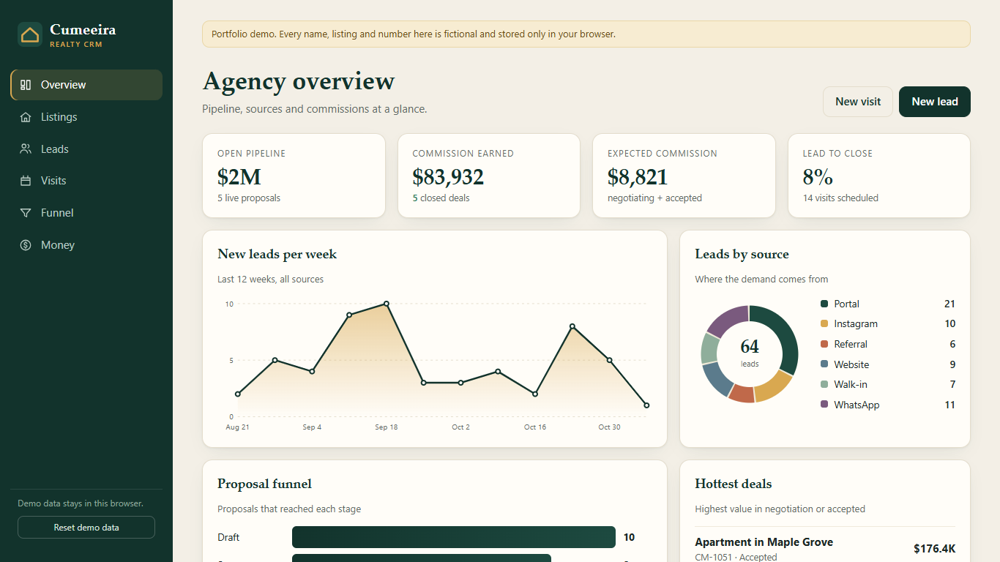
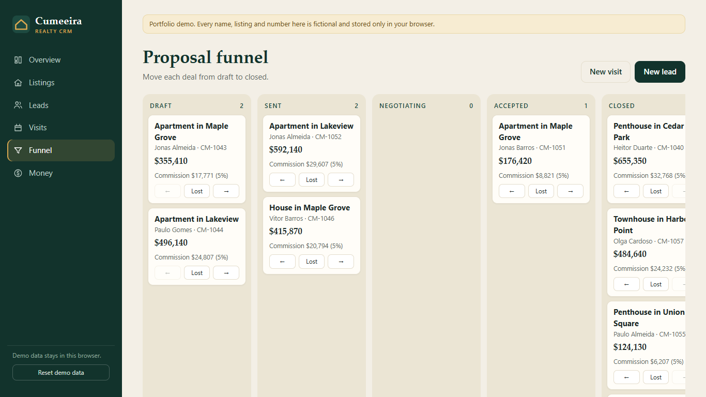
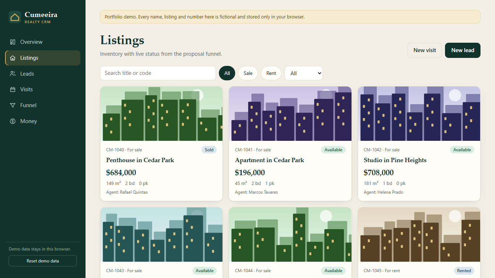
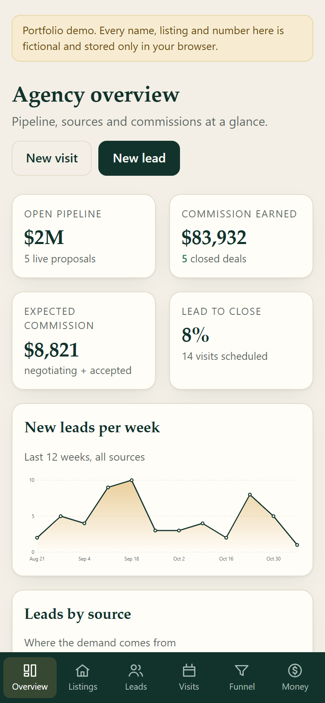

# Cumeeira CRM

A CRM for a real-estate agency, built as a portfolio demo. Vue 3 + TypeScript + Vite, no backend: a Supabase-style data layer runs locally on `localStorage`, seeded with deterministic fictional data.

**Live demo:** https://alissonlittig.github.io/cumeeira-crm/

> All people, listings, prices and numbers are fictional. Nothing leaves your browser.



## What it does

- **Overview**: open pipeline, commission earned vs. expected, lead-to-close rate, weekly lead trend, leads by source, proposal funnel.
- **Listings**: filterable inventory (sale/rent, status, search). Status follows the proposal funnel automatically (Reserved, Sold, Rented).
- **Leads by source**: which channel (Portal, Instagram, Referral, Website, Walk-in, WhatsApp) brings leads that reach a proposal.
- **Visits**: agenda grouped by day, mark done or cancelled, schedule new visits.
- **Funnel**: Draft → Sent → Negotiating → Accepted → Closed board; move or drop deals.
- **Commissions**: earned and expected by agent (5% sale, 8% rent), closed-deals ledger.

| Funnel | Listings | Mobile (390px) |
|---|---|---|
|  |  |  |

## Run it

```bash
npm install
npm run dev      # http://localhost:5173
npm test         # unit tests for commission, funnel and seed logic
npm run build    # type-check + production build
```

## Notes

- Charts (donut, area, bars, funnel) are hand-written SVG: no chart library, ~36 kB gzipped JS in total.
- Listing covers are generated skylines, so there are no photo licenses to worry about.
- State is persisted under the `cumeeira:v1` key; "Reset demo data" restores the seed.
- CI (GitHub Actions) runs tests and the build, then deploys `dist` to GitHub Pages.

## License

MIT
